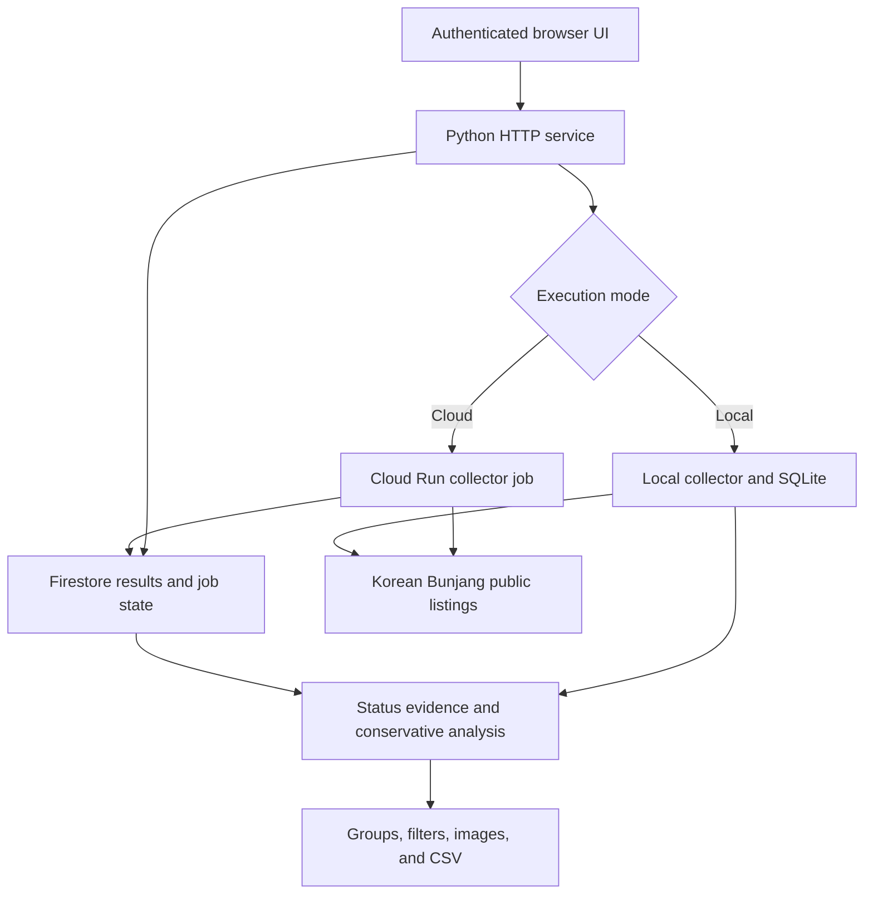

# Brand Lens — Bunjang Research Tool

**A resale-research application that turns Korean Bunjang listing observations into reviewable product groups, separate sold/reserved statistics, and resumable collection jobs.**

I am developing Brand Lens to make resale research more systematic: collect a repeatable sample, retain the evidence behind its status and price, compare similar listings, and run collection from a browser without keeping a personal computer on.

| At a glance | |
| --- | --- |
| My role | Project owner and developer across collection, data analysis, authentication, web UI, and cloud job orchestration |
| Stage | Working local application with implemented Cloud Run/Firestore adapters; active development |
| Engineering focus | Evidence-aware statistics, resumable collection, shared job state, and uncertainty-aware job submission |
| This repository | Public case study and a small runnable code example; the full application and collected data remain private |

[Problem and motivation](#problem-and-motivation) · [Architecture](#architecture) · [Core engineering](#core-engineering) · [Technology stack](#technology-stack) · [Runnable example](#runnable-example)

## Deployed application

[Open the deployed sign-in page](https://bunjang-web-x5omgavbua-du.a.run.app/login)

The web service is deployed on Google Cloud Run. Access requires an administrator-provisioned account; public registration is not available. Recruiters can review the case study and [run the standalone sample](examples/) without an account, or arrange a guided application walkthrough.

**Browser verification:** the deployment redirected to its rendered sign-in page on 18 October 2026. Authenticated research screens, background-job execution, and collection results have not yet been verified in this walkthrough.

## Problem and motivation

For resale research, an asking price alone is a weak signal. A useful comparison also needs to distinguish a listed item from a reserved item or a listing marked sold, identify whether the products are actually comparable, and explain what is known about the date.

The project grew from a practical workflow: compare products and candidate purchase prices against observed Korean resale listings, without treating an incomplete search sample as the entire market.

| Research need | Application response |
| --- | --- |
| Separate apparent demand from available inventory | Keep selling, reserved, and sold-marked states distinct |
| Check whether a recent period is actually evidenced | Separate observed state-change windows from listing-update dates |
| Compare like-for-like products | Use explicit model codes or conservative title groups, with manual group review |
| Find visually similar candidates | Compare lightweight image features and retain the need for model verification |
| Continue collection after interruption | Preserve page-level results and collection checkpoints |
| Start work remotely | Dispatch a background cloud job and persist progress/results independently of the browser |

This is a product rationale based on a concrete research workflow, not a claim of independently measured market size, resale profit, or customer adoption.

## What the current application includes

- Browser controls for brands, collection limits, filters, progress, cancellation, and saved results.
- Cursor-based collection of Korean Bunjang public search results, with bounded retries and adaptive pacing.
- SQLite persistence locally and Firestore-backed data/account/session adapters for the cloud path.
- Status observation history, conservative grouping, category filters, price summaries, manual corrections, and CSV export.
- Lightweight image similarity using color, coarse layout, and edge features.
- A purchase-cost calculator interface to support comparison alongside listing evidence.
- Administrator-provisioned accounts, revocable sessions, login throttling, and CSRF checks.
- Browser-triggered Cloud Run Jobs with shared progress, cancellation, and submission state.

The implementation inspected for this case study uses deterministic analysis and Pillow-based image features. AI-assisted identification is not presented as an implemented or validated capability here.

## Architecture

The local and cloud modes share the analysis workflow but have different storage and cancellation mechanisms.

The cloud path allows a collection job to outlive a browser request. It does not rely on an always-running laptop or an in-memory event shared between separate processes. The deployed sign-in page has been observed; authenticated worker execution and deployment health beyond that entry point remain outside this verification.

## Core engineering

### 1. Keep observed evidence separate from inferred transactions

**Decision:** retain listing state, observation time, and the interval in which a state transition was observed.

A listing first encountered as sold has an unknown sale date. Its update timestamp does not establish when a buyer completed a transaction. The analysis therefore exposes distinct modes for observed transitions, recently updated listings as a reference sample, and the saved latest-state snapshot.

**Why it matters:** labeling every recently updated sold listing as a recent sale would create a precise-looking statistic from unsupported evidence.

The implementation also keeps reserved listings out of sold-only price summaries, excludes zero prices from those summaries, and deduplicates by listing ID. A sold-marked listing price remains a **posted price**, not a verified final payment amount.

### 2. Make interrupted collection recoverable

**Decision:** save collected items and cursor/checkpoint state after successful pages, and retry transient failures on the same cursor.

The collection path uses bounded retries, backoff, Retry-After handling, and persisted request pacing. Access-denied responses stop the path rather than triggering attempts to bypass restrictions. Duplicate-page/no-progress detection prevents a repeated cursor from being mistaken for successful completion.

**Trade-off:** cursor pagination still requires traversing earlier search pages. Starting analysis later in the sequence does not eliminate those preceding requests or guarantee complete market coverage.

### 3. Use persistent state for cross-process cancellation

**Decision:** express progress and cancellation through Firestore in cloud mode, while retaining an event-based local implementation.

The web process and cloud worker do not share memory. The cancellation adapter provides the same event-style operations, including a wait operation that checks the persisted cancellation state during retry delays.

**Why it matters:** a cancellation flag that works in a single local process can fail when the producer and worker run independently. The adapter boundary lets the collector retain the same cancellation contract across execution modes.

### 4. Do not blindly repeat a job submission after a timeout

**Decision:** reserve a job token before dispatch, disable automatic submission retries, and retain an unknown submission state when acceptance is uncertain.

A slow response can occur after Cloud Run has accepted a job. Immediately retrying a non-idempotent submission risks starting duplicate collectors. The implementation retains its token/state for worker and execution reconciliation instead of treating every timeout as a definite rejection.

**Trade-off:** the UI may temporarily have less certainty about submission, but the system preserves the information needed to resolve it without silently duplicating work.

### 5. Prefer reviewable matching over false precision

**Decision:** group explicit model codes before normalized titles, keep weak titles separate, and allow users to merge or split candidates.

Image similarity supplements candidate review using a coarse RGB grid, HSV histogram, and horizontal edge features. It can rank visual resemblance; it does not prove model identity, condition, or authenticity.

**Why it matters:** two photographs can share a background or color while showing different products. The interface and analysis need to preserve that distinction.

## Technology stack

| Layer | Technology | Responsibility |
| --- | --- | --- |
| Application server | Python, standard-library HTTP server | Authenticated browser/API workflow and task controls |
| Collection | Python HTTP clients, cursor handling, adaptive request pacing | Public-listing retrieval, retries, and interruption recovery |
| Local data | SQLite | Listings, observations, groups, checkpoints, accounts, and sessions |
| Cloud data | Google Cloud Firestore | Shared data, progress, cancellation, account/session adapters, and run snapshots |
| Background execution | Google Cloud Run Jobs | Browser-triggered collector execution |
| Web interface | JavaScript, HTML/CSS | Research filters, status display, grouping, image comparison, and CSV workflow |
| Image features | Pillow | Color/layout/edge feature extraction and similarity scoring |
| Delivery | Docker, Cloud Build configuration, GitHub Actions | Container build/deployment definitions and repository checks |
| Verification | Python unittest and browser test scripts | Analysis semantics, network recovery, auth, cloud adapters, and UI paths |

## Runnable example

[Inspect and run the image-similarity sample](examples/). It is a source-derived standalone module with tests and a demo using generated, synthetic images. It makes no marketplace requests, requires no cloud credentials, and publishes no collected listing data.

The example demonstrates one implemented mechanism. It does not expose the full collection application or claim to authenticate clothing.

## My contribution

- Defining research filters and the distinction between observed status evidence and transaction claims.
- Developing collection, checkpointing, conservative grouping, and price/statistics handling.
- Building the authenticated web workflow and manual group-review controls.
- Adapting local storage/cancellation contracts to Firestore and Cloud Run Jobs.
- Adding image-based candidate comparison and test coverage around the core workflows.

## Verification and current boundaries

The private repository contains analysis, network, authentication, cloud-adapter, image-similarity, and browser tests. This documentation update validates the public standalone sample separately; it does not rerun live marketplace collection or certify the deployed service.

- Public search samples do not establish total transaction volume or exact historical sale dates.
- Titles, posted prices, and platform status labels require careful interpretation.
- Visual similarity is a candidate-ranking aid, not an authenticity or exact-model verdict.
- Collection depends on the availability and behavior of the upstream public interface.
- Local mode needs a running local process; cloud job behavior depends on the configured cloud deployment.
- AI-assisted matching and further accuracy improvements remain separate development work.

## Reviewing the project

The central technical question is: **how can a research tool remain useful while being honest about incomplete data, recoverable collection, and uncertain job execution?**

A technical walkthrough and scoped review of the private implementation can be arranged on request.

[Sunmin Lee — GitHub profile](https://github.com/sunminlee-ucd) · [LinkedIn](https://www.linkedin.com/in/sunmin-dev/)

*Implementation and supporting documentation reviewed on 18 October 2026. This is an independent project, not an official Bunjang product.*
